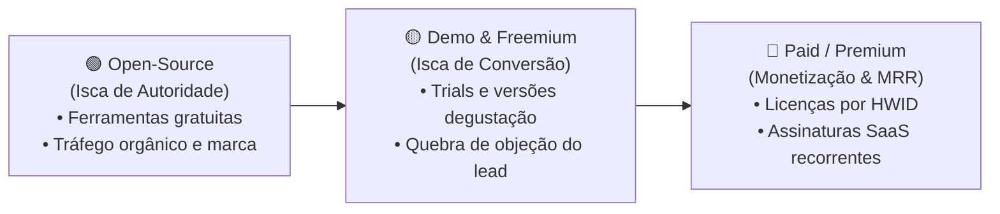

# 🏢 RPsecti Soluções Inteligentes

Catálogo de ferramentas e produtos inteligentes para produtividade, automação e alto desempenho, desenvolvidas pela **RPsecti Soluções Inteligentes**.

---

## 🎯 Modelo de Portfólio & Esteira de Produtos

Nossa arquitetura de produtos é dividida em três categorias estratégicas para garantir geração de tráfego, atração de clientes e monetização acelerada:

1. **🟢 Open-Source (Isca de Autoridade):** Softwares 100% abertos e gratuitos que resolvem problemas reais com extrema leveza, construindo reputação institucional para a RPsecti.
2. **🟡 Demo & Freemium (Isca de Conversão):** Versões limitadas (por tempo, recursos ou volume) de produtos comerciais, liberadas gratuitamente como degustação para captação agressiva de leads qualificados.
3. **🔴 Paid / Premium (Linha Comercial):** Produtos completos de alto valor agregado, protegidos por licenças atreladas a Hardware ID (HWID) ou assinaturas SaaS recorrentes via Pix.

---

## 📂 Portfólio de Produtos

| Produto | Categoria | Modelo de Acesso / Isca Comercial | Diretório | Status |
| :--- | :---: | :--- | :--- | :---: |
| **RPsec Recorder** | 🟢 Open-Source | **100% Gratuito & Livre** • Isca de autoridade institucional • Gravador ultra-leve (< 40MB) para criadores e devs | [`gravador_windows/`](gravador_windows/) | 🟢 Concluído |
| **RPsec Link** | 🟢 Open-Source / 🔴 Paid | **Acesso Remoto Ultraleve (Web Browser)** • *Isca/Open:* Acesso local direto sem limites de tempo ou pop-ups • *Paid:* Painel central multi-máquinas e acesso desatendido | [`rpsec_link/`](rpsec_link/) | 🟢 MVP Operacional |
| **RPsec DDTank Bot (Sky City)** | 🔴 Paid / 🟡 Demo | **Licença Paga + Trial Gratuito (Isca)** • *Isca/Demo:* Teste grátis de 24h ou modo 1 quadrante • *Paid:* Licença HWID completa para 4 instâncias com aceleração | [`rpsec_ddtank/`](rpsec_ddtank/) | 🟡 MVP Operacional |
| **RPsec Balcão (SalgadoFácil)** | 🔴 Paid / 🟡 Demo | **SaaS Freemium (Isca Local)** • *Isca/Demo:* Versão local 100% gratuita para teste no balcão • *Paid:* Assinatura Cloud (R$ 29,90/mês) com backup e multi-telas | [`rpsec_balcao/`](rpsec_balcao/) | 🟡 Em Estruturação |

---

## 🎣 Estratégia de Iscas & Captação de Clientes

### 1. Isca do DDTank Bot (Gaming)
- **A Isca:** Liberar um executável demonstrativo de 24 horas ou limitado a 1 janela com detecção automática de mira e disparo assistido.
- **A Conversão:** O jogador vê o bot funcionando em tempo real, experimenta a precisão e sente a necessidade imediata de comprar a versão completa com as 4 contas operando juntas no Sky City.
- **Canal de Venda:** Servidores do Discord e grupos de guildas de DDTank.

### 2. Isca do RPsec Balcão (Comércio & Salgaderias)
- **A Isca:** O comerciante pode utilizar o app web localmente de forma gratuita, cadastrando seus produtos e operando as vendas do dia sem pagar nada.
- **A Conversão:** Ao perceber o controle imediato do caixa e a eliminação de furos financeiros, o comerciante assina a versão Cloud para sincronizar no celular e salvar backups automáticos.
- **Canal de Venda:** Venda consultiva direta em pequenos estabelecimentos e indicação de balcão a balcão.

### 3. Isca do RPsec Link (Suporte & Acesso Remoto)
- **A Isca:** Acesso remoto direto via navegador para profissionais de TI, técnicos e gamers que estão fartos dos limites e pop-ups do TeamViewer/AnyDesk.
- **A Conversão:** Venda de licença comercial corporativa para empresas de suporte com painel de múltiplos computadores e acesso desatendido por senha mestra.
- **Canal de Venda:** Comunidades de suporte técnico, fóruns de TI e clientes diretos da RPsecti.

---

## 👥 Metodologia & Equipe de Agentes
Cada solução é concebida, projetada e desenvolvida pela equipe corporativa de especialistas virtuais da RPsecti sob governança do PMO Lead e supervisão técnica do CTO Marcus.
